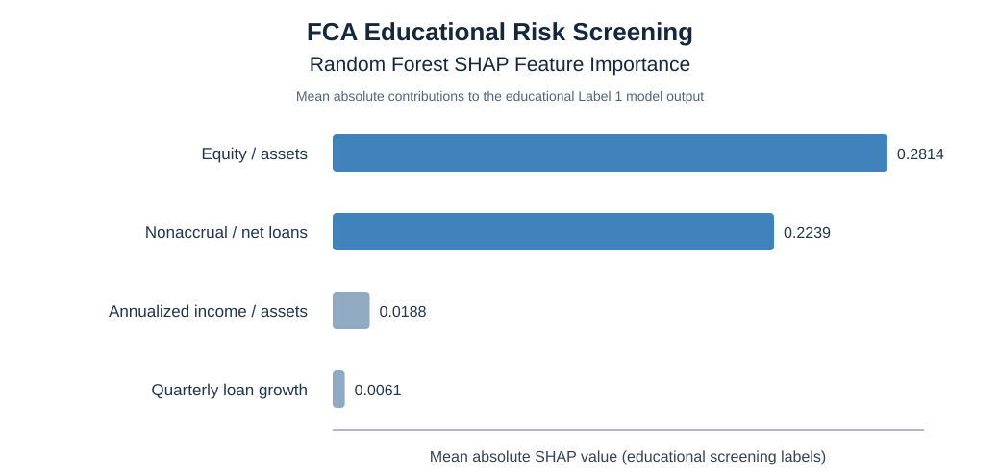

# FCA Educational Risk Classification and Explainable AI

**Independent educational machine-learning extension** of the [Farm Credit Financial Risk Analytics project](../../README.md). Not affiliated with or endorsed by the Farm Credit Administration.

> **Not a credit-default prediction system.** The target labels are generated from a financial-ratio screening rule, not observed defaults, institutional distress, or supervisory findings. Evaluation measures how well models reproduce the illustrative rule.

## Scope and data

- **177** corrected financial observations, representing **59 institutions** across **2026 Q1–Q3**
- Data are based on public FCA quarterly reports processed by the original project's corrected financial-data workflow
- **141 observations / 47 institutions** in training; **36 observations / 12 institutions** held out for testing
- **0 institutions** shared between training and test groups
- Four model inputs: quarter-over-quarter loan growth, equity/assets, nonaccrual loans/net loans, and corrected annualized quarterly income/average assets

## Educational target

Two illustrative thresholds, calculated using the 2026 Q1 observations, were applied to the three-quarter panel:

- Nonaccrual loans / net loans **≥ 1.1118942894%**
- Equity / assets **≤ 15.6822382484%**

**Label 1** means at least one condition is met; **Label 0** means neither condition is met. These thresholds are *not* FCA capital, credit-quality, or examination standards. Labels are mechanically derived from features supplied to the classifiers; therefore strong performance does **not** establish real-world predictive validity.

## Model evaluation

The comparison below comes from a **single institution-grouped holdout** (36 observations); models use the default classification threshold.

| Model | Accuracy | Precision | Recall | F1 | ROC-AUC |
| --- | ---: | ---: | ---: | ---: | ---: |
| Logistic Regression | 0.8333 | 0.8333 | 0.7143 | 0.7692 | 0.7890 |
| Random Forest | **0.9722** | **1.0000** | **0.9286** | **0.9630** | **1.0000** |

Confusion matrices, rows actual Label 0/1 and columns predicted Label 0/1:

- Logistic Regression: `[[20, 2], [4, 10]]`
- Random Forest: `[[22, 0], [1, 13]]`

ROC-AUC 1.0 means the Random Forest perfectly ranked the rule-derived positive versus negative cases in this small holdout; one case still fell on the wrong side of the classification threshold. These results are **not** measures of prediction accuracy for actual credit distress.

## Explainability

The Random Forest was analyzed with **SHAP 0.54.1**. The two strongest mean absolute contributions were equity-to-assets (0.2814) and nonaccrual-loan ratio (0.2239), consistent with the factors used to construct the educational labels. SHAP describes model behavior, not causal effects or institution-level financial judgments.

*The SVG is a recreated vector version of the original chart using its four recorded importance values.*

## Repository files

- [Databricks/Jupyter notebook](notebooks/FCA_Credit_Risk_ML.ipynb)
- [Model evaluation CSV](reports/fca_model_comparison.csv)
- [Limitations statement](reports/PROJECT_LIMITATIONS.txt)
- [SHAP importance figure (SVG)](figures/fca_shap_feature_importance.svg)

## Reproduction notes

The notebook expects the corrected FCA Delta table **`workspace.usda_training.fca_financial_metrics`**, created from `output/validation/model_comparison.csv` after the original project's `real_fca_analysis.py` and `validate_models.py` workflows have run. Source FCA quarterly ZIP archives are not stored in this repository. A new workspace must load those public archives and create the table before running the model notebook. The notebook also uses the `raw_files/fca_ml_outputs` Unity Catalog volume for optional figure/report exports.

Python packages used include pandas, NumPy, scikit-learn, matplotlib, MLflow, and SHAP. Run the notebook cells in order; the notebook is an educational artifact rather than a production pipeline. The experiment was tracked in MLflow, with model parameters and evaluation metrics logged.

## Limitations

- Rule-generated labels are not actual defaults, distress events, or FCA regulatory findings
- The same ratios define the labels and serve as model inputs; there is no independent outcome ground truth
- Group separation avoids identical institutions appearing in training and test, but does not independently validate real-world risk prediction
- The evaluation is based on one small, grouped split; results are not robust performance estimates
- SHAP explains the fitted model's classifications rather than real-world causation
- This project is independently created for learning and is neither affiliated with nor endorsed by FCA

See [PROJECT_LIMITATIONS.txt](reports/PROJECT_LIMITATIONS.txt) for a short project statement.
